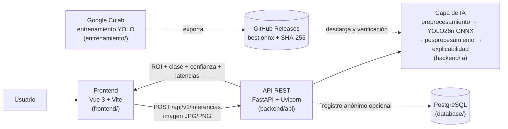

# ColorrectalAI

> Detección e interpretación del cáncer colorrectal mediante imágenes médicas multimodales.

Proyecto académico de la asignatura **Gestión de Proyectos de TI** — Ingeniería de Sistemas, Universidad Santiago de Cali (USC), 2026.


---

## Tabla de contenido

1. [Descripción](#descripción)
2. [Arquitectura](#arquitectura)
3. [Estado de la versión](#estado-de-la-versión)
4. [Estructura del repositorio](#estructura-del-repositorio)
5. [Instalación y ejecución](#instalación-y-ejecución)
6. [Modelo de IA](#modelo-de-ia)
7. [Problema y justificación](#problema-y-justificación)
8. [Objetivos](#objetivos)
9. [Alcance](#alcance)
10. [Requisitos y casos de uso](#requisitos-y-casos-de-uso)
11. [Gestión del proyecto y flujo de trabajo](#gestión-del-proyecto-y-flujo-de-trabajo)
12. [Documentación](#documentación)
13. [Equipo](#equipo)
14. [Aviso importante](#aviso-importante)

---

## Descripción

**ColorrectalAI** es un sistema experimental basado en inteligencia artificial que analiza imágenes de colonoscopia, resalta la **región de interés (ROI)** y entrega una **clasificación experimental** con su **nivel de confianza**, con el fin de apoyar el estudio de la detección e interpretación del cáncer colorrectal.

El proyecto se desarrolla siguiendo buenas prácticas de dirección de proyectos (PMBOK) e ingeniería de requisitos (ISO/IEC/IEEE 29148).

## Arquitectura

Arquitectura **cliente-servidor ** (modelo – API – interfaz):



| Capa | Tecnología | Carpeta |
|---|---|---|
| Presentación | Vue 3, Vite, Vue Router | `frontend/` |
| Servicio (API REST) | FastAPI, Uvicorn, Pydantic | `backend/api/` |
| Inteligencia artificial | YOLO26n exportado a ONNX, ONNX Runtime (CPU) | `backend/ia/` |
| Datos (opcional) | PostgreSQL, SQLAlchemy, psycopg | `database/` |
| Entrenamiento | Ultralytics en Google Colab, dataset PolypGen | `entrenamiento/` |
| Despliegue | Docker en Render (API), GitHub Pages (frontend) | `render.yaml` |
| Integración continua | GitHub Actions (pytest) | `.github/workflows/` |

**Privacidad:** la API procesa cada imagen en memoria y **no la almacena**. La base de datos, si se configura, solo guarda metadatos anónimos de cada solicitud (formato, tamaño, latencia, número de ROI, modelo o error).

## Estado de la versión

**v0.1.0 (pre-release).** El flujo completo funciona de punta a punta, pero la versión **no cumple todavía el criterio de salida de QA**. El detalle está en [`pruebas/`](pruebas/).

| Módulo | Estado |
|---|---|
| Frontend | ✅ Funcional, integrado con la API |
| API de inferencia | ✅ Funcional (latencia p95 local 0.16 s) |
| Modelo YOLO | 🟡 Baseline de 10 épocas; calibración (ECE) por mejorar |
| Base de datos | 🟡 Esquema listo; datos iniciales (`seed`) pendientes |
| Registro de usuarios | ⏳ Pendiente (el formulario actual es de demostración) |
| Pruebas QA | 🟡 Primera ronda: 3 de 12 casos *Must* aprobados, defectos registrados |

## Estructura del repositorio

```text
ColorrectalAI-proyect/
├── frontend/              # Interfaz web (Vue 3 + Vite)
├── backend/               # API de inferencia
│   ├── api/               #   rutas, validación, admisión, errores, registro en BD
│   ├── ia/                #   preprocesamiento, adaptador YOLO (ONNX), posprocesamiento, explicabilidad
│   ├── tests/             #   pruebas con pytest (modelo falso, no requiere el .onnx)
│   └── modelos/           #   aquí va best.onnx (no se versiona; se publica en Releases)
├── database/              # Esquema PostgreSQL y guía de instalación
├── entrenamiento/         # Cuaderno de Colab y registro del experimento
├── pruebas/               # Informe de QA, Excel TSP y pre-prueba de usabilidad
├── .github/workflows/     # CI: pruebas del backend en cada push y pull request
├── render.yaml            # Despliegue de la API en Render
└── README.md
```

`backend/`, `frontend/` y `database/` tienen su propio `README.md`. El de `entrenamiento/` está pendiente (DEF-12 del informe de QA).

## Instalación y ejecución

**Requisitos:** Python 3.12, Node.js 20 o superior, y el archivo `best.onnx` (disponible en [Releases](../../releases)).

### Backend (API)

```sh
cd backend
python -m venv .venv && source .venv/bin/activate      # Windows: .venv\Scripts\activate
pip install -r requirements-dev.txt
cp .env.example .env
# copiar best.onnx en backend/modelos/
uvicorn api.main:app --reload
pytest -q
```

Documentación interactiva de la API: <http://localhost:8000/docs>

| Método | Ruta | Descripción |
|---|---|---|
| GET | `/api/v1/salud` | Estado del servicio, versión y SHA-256 del modelo |
| POST | `/api/v1/inferencias` | Recibe una imagen (`imagen`, JPG/PNG) y devuelve ROI, clasificación, confianza y latencias |

### Frontend

```sh
cd frontend
npm install
npm run dev
```

Abre <http://localhost:5173>. En producción, define `VITE_API_URL` con la URL de la API desplegada.

### Base de datos (opcional)

Ver [`database/README.md`](database/). Si no se define `DATABASE_URL`, la API funciona igual sin base de datos.

## Modelo de IA

| Parámetro | Valor |
|---|---|
| Modelo | YOLO26n (detección), exportado a ONNX |
| Dataset | PolypGen (CC BY 4.0) |
| Partición | Por centro: entrenamiento C1–C4, validación C5, prueba C6 (ningún paciente en dos grupos) |
| Entrenamiento | 10 épocas, imagen 640 px, semilla 42 |
| Prueba (C6, 520 imágenes) | mAP@0.5 0.728 · sensibilidad 0.838 · especificidad 0.788 · F1 0.883 · ROC-AUC 0.901 · ECE 0.256 |
| SHA-256 de `best.onnx` | `b4c98b3538b28f2f22e7fbe6eaabff05662ad70cc9556de45bf881127a2410f3` |

El detalle completo está en [`entrenamiento/registro_experimento.json`](entrenamiento/registro_experimento.json).

## Problema y justificación

El cáncer colorrectal es una enfermedad en la que la detección temprana marca una diferencia importante en el pronóstico. La revisión de imágenes de colonoscopia demanda tiempo y experiencia, y la interpretación puede variar entre observadores. ColorrectalAI explora cómo una herramienta de apoyo basada en redes neuronales puede ayudar a **priorizar, resaltar y cuantificar la certeza** de los hallazgos visuales, sirviendo como complemento al criterio profesional.

## Objetivos

### Objetivo general

Desarrollar un sistema experimental que permita la detección e interpretación del cáncer colorrectal mediante imágenes médicas multimodales, aplicando un proceso formal de gestión de proyectos de TI.

### Objetivos específicos

- Levantar, documentar y validar los requisitos funcionales y no funcionales del sistema conforme a la norma ISO/IEC/IEEE 29148.
- Priorizar los requisitos mediante la técnica **MoSCoW** y mantener su **trazabilidad** durante todo el ciclo del proyecto.
- Modelar el sistema mediante casos de uso y definir su arquitectura de software.
- Clasificar imágenes de colonoscopia, mostrando la región de interés (ROI) y el nivel de confianza de cada resultado.
- Diseñar la base de datos del sistema siguiendo las fases de requisitos, modelo conceptual, lógico, físico e implementación/optimización.
- Planificar y controlar el **alcance** y la **calidad** del proyecto según PMBOK.

## Alcance

### Incluye

- Clasificación experimental de imágenes de colonoscopia.
- Visualización de la ROI y del nivel de confianza del resultado.
- Documentación completa del proyecto: formulación, matriz de partes interesadas, matriz de trazabilidad de requisitos, ERS, plan de gestión del alcance, plan para la dirección del proyecto, arquitectura y diseño de base de datos.
- Priorización de requisitos con MoSCoW.
- Modelado de casos de uso y casos de prueba.

### No incluye

- Uso clínico real o sustitución del criterio médico.
- Almacenamiento de las imágenes cargadas por el usuario.
- Los requisitos clasificados como *Won't have* (W1–W5) en la matriz MoSCoW.
- Gestión de costos y de recursos dentro del plan de dirección del proyecto (el plan se limita a alcance y calidad).

## Requisitos y casos de uso

| Elemento | Cantidad / referencia |
|---|---|
| Requisitos especificados en la ERS | 27 |
| Casos de prueba | 16 (CP-01 a CP-16) |
| Casos de uso | CU-01 a CU-13 |
| Priorización | MoSCoW (Must / Should / Could / Won't) |
| Estándar de especificación | ISO/IEC/IEEE 29148 |

La **Matriz de Trazabilidad de Requisitos** vincula cada requisito con su caso de uso, su prioridad y su caso de prueba.

## Gestión del proyecto y flujo de trabajo

- **Marco de referencia:** PMBOK (6.ª ed.) y plantillas PM²; desarrollo con Team Software Process (TSP).
- **Ramas:** `develop` (desarrollo) → `qa` (pruebas) → `main` (versiones etiquetadas). Las tres están protegidas: todo cambio entra por *pull request*.
- **Contribuir:** cada integrante trabaja en `develop` de su *fork* y abre un *pull request* hacia `develop` de este repositorio.
- **Commits:** formato [Conventional Commits](https://www.conventionalcommits.org/es/) (`feat`, `fix`, `docs`, `test`, `refactor`, `chore`, `ci`).
- **Versiones:** cada paso a `main` se etiqueta (`vX.Y.Z`) y el modelo se publica en el Release con su SHA-256.

## Documentación

| Documento | Descripción |
|---|---|
| Formulación del proyecto | Contexto, justificación y objetivos |
| Matriz de partes interesadas | Identificación y análisis de interesados (PM²) |
| Matriz de trazabilidad de requisitos | Requisitos funcionales y no funcionales |
| Diagrama MoSCoW | Priorización de requisitos |
| Diagrama de casos de uso | CU-01 a CU-13 |
| ERS (ISO/IEC/IEEE 29148) | Especificación de requisitos de software |
| Plan de gestión del alcance | Alcance según PMBOK |
| Plan para la dirección del proyecto | Alcance y calidad |
| Arquitectura de software | Estilo arquitectónico y componentes |
| Diseño de base de datos | Cinco fases; implementado en PostgreSQL (`database/`) |

## Equipo

| Integrante | Rol |
|---|---|
| Edwin Cabezas Cuero | Líder del proyecto |
| Camilo Steban Mutis Arango | Líder de desarrollo y QA |
| Alejandro Guzman Posada | Desarrollador (backend y modelo de IA) |
| Juan Stevan Loza Gutiérrez | Desarrollador UI |
| Juan Fernando Sánchez Hoyos | Planificador |
| Jair Enrique Castro Sanclemente | Docente, gerente del proyecto y patrocinador |

## Aviso importante

ColorrectalAI es un proyecto **académico y experimental**. Sus resultados **no constituyen un dictamen médico** ni reemplazan la valoración de un profesional de la salud. No debe utilizarse para decisiones clínicas.

---

Universidad Santiago de Cali · Facultad de Ingeniería · Ingeniería de Sistemas · 2026
