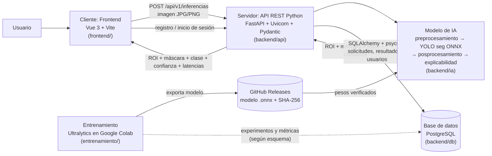

# ColorrectalAI

> Detección e interpretación del cáncer colorrectal mediante imágenes médicas multimodales.

Proyecto académico de la asignatura **Gestión de Proyectos de TI** — Ingeniería de Sistemas, Universidad Santiago de Cali (USC), 2026.


---

## Tabla de contenido

1. [Descripción](#descripción)
2. [Arquitectura](#arquitectura)
3. [Estado de la versión](#estado-de-la-versión)
4. [Estructura del repositorio](#estructura-del-repositorio)
5. [Instalación y ejecución](#instalación-y-ejecución)
6. [Modelo de IA](#modelo-de-ia)
7. [Problema y justificación](#problema-y-justificación)
8. [Objetivos](#objetivos)
9. [Alcance](#alcance)
10. [Requisitos y casos de uso](#requisitos-y-casos-de-uso)
11. [Gestión del proyecto y flujo de trabajo](#gestión-del-proyecto-y-flujo-de-trabajo)
12. [Documentación](#documentación)
13. [Equipo](#equipo)
14. [Aviso importante](#aviso-importante)

---

## Descripción

**ColorrectalAI** es un sistema experimental basado en inteligencia artificial que analiza imágenes de colonoscopia, resalta la **región de interés (ROI)** y entrega una **clasificación experimental** con su **nivel de confianza**, con el fin de apoyar el estudio de la detección e interpretación del cáncer colorrectal.

El proyecto se desarrolla siguiendo buenas prácticas de dirección de proyectos (PMBOK) e ingeniería de requisitos (ISO/IEC/IEEE 29148).

**En línea:** <https://colorrectalai-production.up.railway.app> (versión publicada desde `main`).

## Arquitectura

ColorrectalAI usa una arquitectura **cliente-servidor en capas**. El **cliente** es una aplicación web en Vue 3 (`frontend/`). El **servidor** es una API REST en Python con FastAPI (`backend/api/`), que ejecuta el **modelo de IA** YOLO de segmentación en formato ONNX (`backend/ia/`) y guarda en la **base de datos PostgreSQL** el registro de cada solicitud, los resultados y las cuentas de usuario. El proyecto se integra al ecosistema ONCO-AI_USC 2026 B.

### Componentes y flujo de datos

1. **Cliente (Frontend, `frontend/`)**: aplicación web con Vue 3, Vite y Vue Router. El usuario crea su cuenta o inicia sesión, sube una o varias imágenes JPG o PNG y las envía al servidor con `POST /api/v1/inferencias`. Muestra la ROI, la máscara de segmentación, la comparación visual y el historial local.
2. **Servidor (API REST en Python, `backend/api/`)**: construido con FastAPI, Uvicorn y Pydantic. Valida la imagen, controla la admisión de solicitudes, maneja los errores, coordina la inferencia y gestiona el registro y el inicio de sesión (contraseña con hash scrypt y token firmado).
3. **Modelo de IA (`backend/ia/`)**: pipeline en Python de preprocesamiento, YOLO de segmentación (`seg-0.1`) exportado a ONNX y ejecutado con ONNX Runtime en CPU, posprocesamiento y explicabilidad. Devuelve ROI, clase, confianza y la máscara de la región.
4. **Base de datos PostgreSQL (`backend/db/`)**: la API la usa mediante SQLAlchemy y psycopg. Al arrancar aplica el esquema y los datos iniciales por sí sola, y registra el modelo cargado por su SHA-256. Guarda cada solicitud de inferencia (formato, tamaño, latencia, número de ROI, modelo o error), los resultados por ROI, las cuentas de usuario, los experimentos, las versiones del modelo y sus métricas. Guía en [`database/README.MD`](database/README.MD).
5. **Entrenamiento (`entrenamiento/`)**: cuaderno de Ultralytics en Google Colab con el dataset PolypGen. Exporta el modelo a ONNX, que se publica en GitHub Releases con su SHA-256. Tiene su README con la guía de reproducción.
6. **Despliegue**: Railway publica desde la rama `main` tres servicios: la API (Docker, `backend/Dockerfile`), el frontend y PostgreSQL. La integración continua corre las pruebas con pytest y un PostgreSQL de pruebas en GitHub Actions (`.github/workflows/`).

### Diagrama



### Capas y tecnologías

| Capa | Tecnología | Carpeta |
|---|---|---|
| Cliente / Presentación | Vue 3, Vite, Vue Router | `frontend/` |
| Servidor / API REST (Python) | FastAPI, Uvicorn, Pydantic | `backend/api/` |
| Modelo de inteligencia artificial (Python) | YOLO de segmentación (`seg-0.1`) exportado a ONNX, ONNX Runtime (CPU) | `backend/ia/` |
| Base de datos | PostgreSQL (migración automática al arrancar), SQLAlchemy, psycopg | `backend/db/`, `database/` |
| Entrenamiento | Ultralytics en Google Colab, dataset PolypGen | `entrenamiento/` |
| Despliegue | Railway: API (Docker), frontend y PostgreSQL, desde `main` | `backend/Dockerfile` |
| Integración continua | GitHub Actions (pytest) | `.github/workflows/` |

**Privacidad:** la API procesa cada imagen en memoria y **no la almacena**. La base de datos solo guarda metadatos anónimos de cada solicitud (formato, tamaño, latencia, número de ROI, modelo o error) y las cuentas de usuario, con la contraseña como hash scrypt (nunca en texto plano).

`backend/`, `frontend/`, `database/` y `entrenamiento/` tienen su propio `README`.

## Estado de la versión

**v0.2.2 (pre-release).** Versión publicada en Railway desde `main`. El flujo completo funciona en producción, pero la versión **todavía no cumple el criterio de salida de QA**: quedan dos defectos altos, ambos del modelo y sus datos. El detalle está en [`pruebas/`](pruebas/).

| Módulo | Estado |
|---|---|
| Frontend | ✅ Funcional; contraste WCAG AA, carga múltiple, comparación visual e historial local |
| API de inferencia | ✅ Funcional (p95 local 0.87 s con el modelo de segmentación) |
| Modelo YOLO | 🟡 Segmentación `seg-0.1` (Release v0.2.0); faltan su cuaderno y sus métricas (Dice, IoU, ECE) |
| Base de datos | ✅ PostgreSQL en Railway, con migración y datos iniciales automáticos |
| Registro de usuarios | ✅ Registro e inicio de sesión reales; contraseña con hash scrypt |
| Pruebas QA | 🟡 Ciclo 3: 23 de 32 casos aprobados, 12 de 16 defectos cerrados · **429 pruebas automatizadas** en el CI (248 backend, 106 frontend, 75 de extremo a extremo en Chrome, Firefox y Edge) |

## Estructura del repositorio

```text
ColorrectalAI-proyect/
├── frontend/              # Cliente: interfaz web (Vue 3 + Vite)
├── backend/               # Servidor: API de inferencia (Python)
│   ├── api/               #   FastAPI: rutas, validación, admisión, errores, registro en BD
│   ├── ia/                #   modelo de IA: preprocesamiento, adaptador YOLO (ONNX), posprocesamiento, explicabilidad
│   ├── db/                #   esquema y datos iniciales de PostgreSQL (se aplican al arrancar)
│   ├── tests/             #   pruebas con pytest (modelo falso; las de base de datos usan TEST_DATABASE_URL)
│   └── modelos/           #   best_seg.onnx, modelo desplegado (también en el Release v0.2.0)
├── database/              # Guía de la base de datos PostgreSQL
├── entrenamiento/         # Cuaderno de Colab, registro del experimento y guía de reproducción
├── pruebas/               # Informes de los ciclos de QA, plan de pruebas, Excel TSP y matriz unitaria
├── .github/workflows/     # CI: pruebas del backend en cada push y pull request
├── render.yaml            # Configuración anterior para Render (en desuso; hoy se usa Railway)
└── README.md
```

## Instalación y ejecución

**Requisitos:** Python 3.12, Node.js 20 o superior y PostgreSQL (opcional en local). El modelo `best_seg.onnx` ya viene en `backend/modelos/` y también está en [Releases](../../releases).

### Backend (API)

```sh
cd backend
python -m venv .venv && source .venv/bin/activate      # Windows: .venv\Scripts\activate
pip install -r requirements-dev.txt
cp .env.example .env          # DATABASE_URL y TOKEN_SECRETO para usar la base de datos
uvicorn api.main:app --reload
pytest -q                     # con TEST_DATABASE_URL también corren las pruebas de PostgreSQL
```

Pruebas del frontend:

```sh
cd frontend
npm test            # unitarias y de componentes (Vitest)
npm run test:e2e    # extremo a extremo (Playwright: Chrome, Firefox y Edge)
```

Documentación interactiva de la API: <http://localhost:8000/docs>

| Método | Ruta | Descripción |
|---|---|---|
| GET | `/api/v1/salud` | Estado del servicio, versión y SHA-256 del modelo |
| POST | `/api/v1/inferencias` | Recibe una imagen (`imagen`, JPG/PNG) y devuelve ROI, máscara, clasificación, confianza y latencias |
| POST | `/api/v1/usuarios` | Crea una cuenta (nombre, correo, contraseña ≥ 8, aceptación del aviso) y devuelve la sesión |
| POST | `/api/v1/sesiones` | Inicia sesión con correo y contraseña |
| GET | `/api/v1/usuarios/yo` | Datos del usuario de la sesión (`Authorization: Bearer`) |

### Frontend

```sh
cd frontend
npm install
npm run dev
```

Abre <http://localhost:5173>. En producción, define `VITE_API_URL` con la URL de la API desplegada.

### Base de datos (PostgreSQL)

Crea una base vacía y define `DATABASE_URL` en `backend/.env`. **No hay que ejecutar scripts**: al arrancar, la API aplica `backend/db/01_esquema.sql` y `backend/db/02_datos_iniciales.sql` y registra el modelo cargado. Sin `DATABASE_URL` la inferencia funciona igual, pero no se guardan registros ni se pueden crear cuentas. Más detalles en [`database/README.MD`](database/README.MD).

## Modelo de IA

**Modelo desplegado:** YOLO de segmentación `seg-0.1` (`backend/modelos/best_seg.onnx`, Release [v0.2.0](../../releases/tag/v0.2.0)), SHA-256 `61bec40566c15624f8319af8e9da197a06c24424f51c7956e21d70ef632ef603`. Su cuaderno de entrenamiento y sus métricas (Dice, IoU, ECE) todavía no están en el repositorio.

**Baseline registrado** (detección, Release v0.1.0):

| Parámetro | Valor |
|---|---|
| Modelo | YOLO26n (detección), exportado a ONNX |
| Dataset | PolypGen (CC BY 4.0) |
| Partición | Por centro: entrenamiento C1–C4, validación C5, prueba C6 (ningún paciente en dos grupos) |
| Entrenamiento | 10 épocas, imagen 640 px, semilla 42 |
| Prueba (C6, 520 imágenes) | mAP@0.5 0.728 · sensibilidad 0.838 · especificidad 0.788 · F1 0.883 · ROC-AUC 0.901 · ECE 0.256 |
| SHA-256 de `best.onnx` | `b4c98b3538b28f2f22e7fbe6eaabff05662ad70cc9556de45bf881127a2410f3` |

El detalle está en [`entrenamiento/registro_experimento.json`](entrenamiento/registro_experimento.json) y la guía para reproducirlo en [`entrenamiento/README.md`](entrenamiento/README.md).

## Problema y justificación

El cáncer colorrectal es una enfermedad en la que la detección temprana marca una diferencia importante en el pronóstico. La revisión de imágenes de colonoscopia demanda tiempo y experiencia, y la interpretación puede variar entre observadores. ColorrectalAI explora cómo una herramienta de apoyo basada en redes neuronales puede ayudar a **priorizar, resaltar y cuantificar la certeza** de los hallazgos visuales, sirviendo como complemento al criterio profesional.

## Objetivos

### Objetivo general

Desarrollar un sistema experimental que permita la detección e interpretación del cáncer colorrectal mediante imágenes médicas multimodales, aplicando un proceso formal de gestión de proyectos de TI.

### Objetivos específicos

- Levantar, documentar y validar los requisitos funcionales y no funcionales del sistema conforme a la norma ISO/IEC/IEEE 29148.
- Priorizar los requisitos mediante la técnica **MoSCoW** y mantener su **trazabilidad** durante todo el ciclo del proyecto.
- Modelar el sistema mediante casos de uso y definir su arquitectura de software.
- Clasificar imágenes de colonoscopia, mostrando la región de interés (ROI) y el nivel de confianza de cada resultado.
- Diseñar la base de datos del sistema siguiendo las fases de requisitos, modelo conceptual, lógico, físico e implementación/optimización.
- Planificar y controlar el **alcance** y la **calidad** del proyecto según PMBOK.

## Alcance

### Incluye

- Clasificación experimental de imágenes de colonoscopia.
- Visualización de la ROI y del nivel de confianza del resultado.
- Documentación completa del proyecto: formulación, matriz de partes interesadas, matriz de trazabilidad de requisitos, ERS, plan de gestión del alcance, plan para la dirección del proyecto, arquitectura y diseño de base de datos.
- Priorización de requisitos con MoSCoW.
- Modelado de casos de uso y casos de prueba.

### No incluye

- Uso clínico real o sustitución del criterio médico.
- Almacenamiento de las imágenes cargadas por el usuario.
- Los requisitos clasificados como *Won't have* (W1–W5) en la matriz MoSCoW.
- Gestión de costos y de recursos dentro del plan de dirección del proyecto (el plan se limita a alcance y calidad).

## Requisitos y casos de uso

| Elemento | Cantidad / referencia |
|---|---|
| Requisitos especificados en la ERS | 27 |
| Casos de prueba | 32: CP-01 a CP-16, CF-01 a CF-06, RG-01 a RG-06, ES-01 a ES-03 y prueba de humo |
| Casos de uso | CU-01 a CU-13 |
| Priorización | MoSCoW (Must / Should / Could / Won't) |
| Estándar de especificación | ISO/IEC/IEEE 29148 |

La **Matriz de Trazabilidad de Requisitos** vincula cada requisito con su caso de uso, su prioridad y su caso de prueba.

## Gestión del proyecto y flujo de trabajo

- **Marco de referencia:** PMBOK (6.ª ed.) y plantillas PM²; desarrollo con Team Software Process (TSP).
- **Ramas:** solo tres ramas permanentes: `develop` (desarrollo) → `qa` (pruebas) → `main` (versiones etiquetadas, la que publica Railway). Todo cambio entra por *pull request* y las ramas de trabajo se borran al fusionarse.
- **Contribuir:** cada integrante trabaja en `develop` de su *fork* y abre un *pull request* hacia `develop` de este repositorio.
- **Commits:** formato [Conventional Commits](https://www.conventionalcommits.org/es/) (`feat`, `fix`, `docs`, `test`, `refactor`, `chore`, `ci`).
- **Versiones:** cada paso a `main` se etiqueta (`vX.Y.Z`) y el modelo se publica en el Release con su SHA-256. Versión actual: **v0.2.2**.

## Documentación

| Documento | Descripción |
|---|---|
| Formulación del proyecto | Contexto, justificación y objetivos |
| Matriz de partes interesadas | Identificación y análisis de interesados (PM²) |
| Matriz de trazabilidad de requisitos | Requisitos funcionales y no funcionales |
| Diagrama MoSCoW | Priorización de requisitos |
| Diagrama de casos de uso | CU-01 a CU-13 |
| ERS (ISO/IEC/IEEE 29148) | Especificación de requisitos de software |
| Plan de gestión del alcance | Alcance según PMBOK |
| Plan para la dirección del proyecto | Alcance y calidad |
| Arquitectura de software | Estilo arquitectónico y componentes |
| Diseño de base de datos | Cinco fases; implementado en PostgreSQL (`backend/db/`) |
| Plan de pruebas y plan de control de calidad | Casos, criterios de aceptación y resultados de los ciclos de QA (`pruebas/`) |

## Equipo

| Integrante | Rol |
|---|---|
| Edwin Cabezas Cuero | Líder del proyecto |
| Camilo Steban Mutis Arango | Líder de desarrollo y QA |
| Alejandro Guzman Posada | Desarrollador (backend y modelo de IA) |
| Juan Stevan Loza Gutiérrez | Desarrollador UI |
| Juan Fernando Sánchez Hoyos | Planificador |
| Jair Enrique Castro Sanclemente | Docente, gerente del proyecto y patrocinador |

## Aviso importante

ColorrectalAI es un proyecto **académico y experimental**. Sus resultados **no constituyen un dictamen médico** ni reemplazan la valoración de un profesional de la salud. No debe utilizarse para decisiones clínicas.

---

Universidad Santiago de Cali · Facultad de Ingeniería · Ingeniería de Sistemas · 2026
